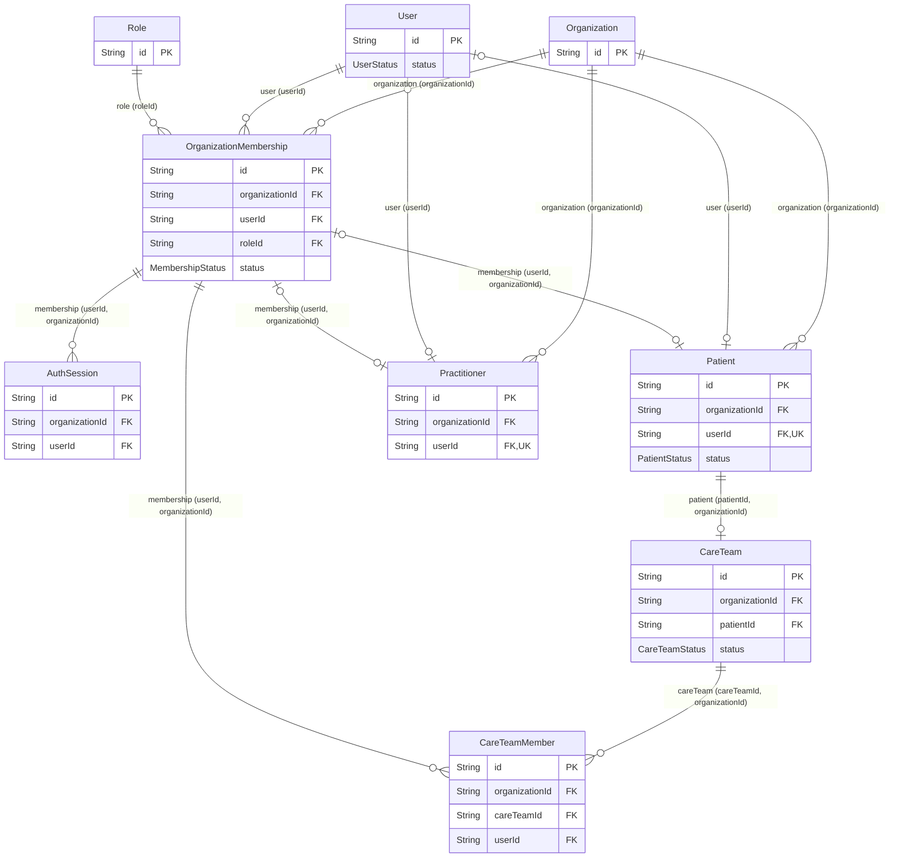
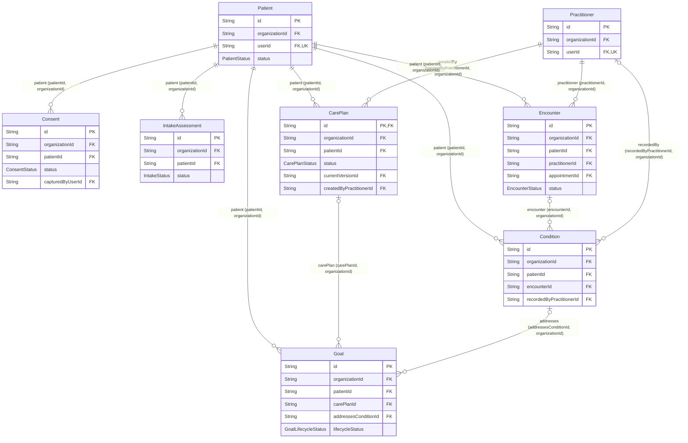
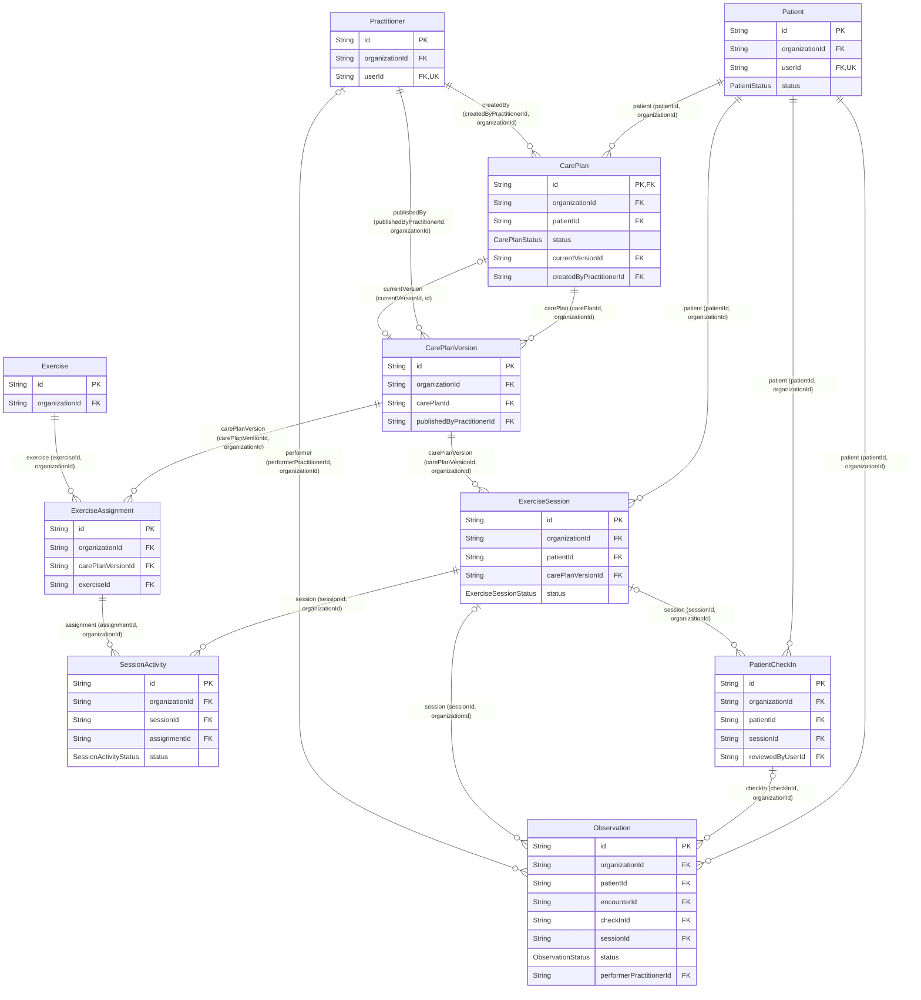
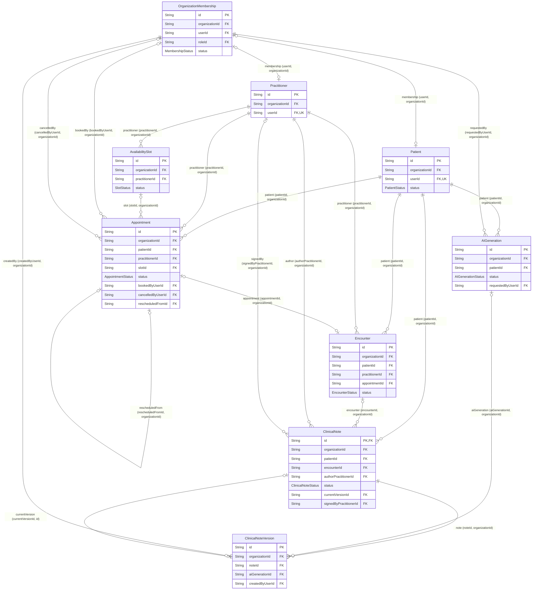
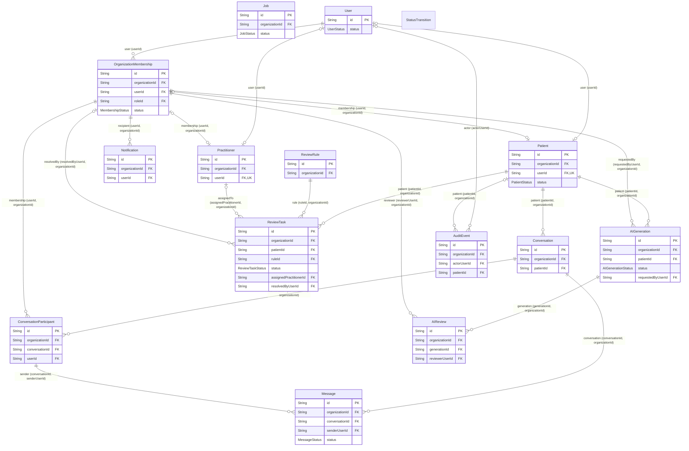

# CarePath entity relationship diagram

Generated from `packages/db/prisma/schema.prisma` (Prisma 7.10.1) on 2026-11-19 and checked by hand. Synthetic data only; not for clinical use.

Read with `docs/architecture/domain-model.md`, which explains organization boundaries, status transitions and the constraints that live in raw SQL. Diagrams list key columns only (PK, FK, unique, status); `schema.prisma` is the full definition.

Conventions in every diagram:

- Every table except `User`, `Role` and `StatusTransition` has `organizationId` (nullable only on `AuditEvent` and `Job`). The many edges to `Organization` are drawn only in the first diagram.
- Edge labels show the relation field and its foreign-key columns. A label such as `patient (patientId, organizationId)` is a composite key into `Patient(id, organizationId)`, which is what makes a cross-organization reference impossible.
- Edges to `OrganizationMembership` use `(userId, organizationId)`: the acting user must belong to the same organization.
- Cardinality is read from the schema: `o|` means at most one child per parent (a unique key on the foreign-key columns).

## Overview

All 37 tables and their foreign keys, without columns.

```mermaid
erDiagram
  Organization ||--o{ OrganizationMembership : "organization"
  User ||--o{ OrganizationMembership : "user"
  Role ||--o{ OrganizationMembership : "role"
  OrganizationMembership ||--o{ AuthSession : "membership"
  User |o--o| Patient : "user"
  OrganizationMembership |o--o| Patient : "membership"
  User |o--o| Practitioner : "user"
  OrganizationMembership |o--o| Practitioner : "membership"
  Patient ||--o| CareTeam : "patient"
  CareTeam ||--o{ CareTeamMember : "careTeam"
  OrganizationMembership ||--o{ CareTeamMember : "membership"
  Patient ||--o{ Consent : "patient"
  OrganizationMembership |o--o{ Consent : "capturedBy"
  Patient ||--o{ IntakeAssessment : "patient"
  Patient ||--o{ Condition : "patient"
  Encounter |o--o{ Condition : "encounter"
  Practitioner |o--o{ Condition : "recordedBy"
  Patient ||--o{ Goal : "patient"
  CarePlan |o--o{ Goal : "carePlan"
  Condition |o--o{ Goal : "addresses"
  Patient ||--o{ CarePlan : "patient"
  Practitioner ||--o{ CarePlan : "createdBy"
  CarePlanVersion |o--o| CarePlan : "currentVersion"
  CarePlan ||--o{ CarePlanVersion : "carePlan"
  Practitioner ||--o{ CarePlanVersion : "publishedBy"
  CarePlanVersion ||--o{ ExerciseAssignment : "carePlanVersion"
  Exercise ||--o{ ExerciseAssignment : "exercise"
  Patient ||--o{ ExerciseSession : "patient"
  CarePlanVersion ||--o{ ExerciseSession : "carePlanVersion"
  ExerciseSession ||--o{ SessionActivity : "session"
  ExerciseAssignment ||--o{ SessionActivity : "assignment"
  Patient ||--o{ PatientCheckIn : "patient"
  ExerciseSession |o--o{ PatientCheckIn : "session"
  OrganizationMembership |o--o{ PatientCheckIn : "reviewedBy"
  Patient ||--o{ Observation : "patient"
  Encounter |o--o{ Observation : "encounter"
  PatientCheckIn |o--o{ Observation : "checkIn"
  ExerciseSession |o--o{ Observation : "session"
  Practitioner |o--o{ Observation : "performer"
  Practitioner ||--o{ AvailabilitySlot : "practitioner"
  Patient ||--o{ Appointment : "patient"
  Practitioner ||--o{ Appointment : "practitioner"
  AvailabilitySlot |o--o{ Appointment : "slot"
  OrganizationMembership |o--o{ Appointment : "bookedBy"
  OrganizationMembership |o--o{ Appointment : "cancelledBy"
  Appointment |o--o| Appointment : "rescheduledFrom"
  Patient ||--o{ Encounter : "patient"
  Practitioner ||--o{ Encounter : "practitioner"
  Appointment |o--o| Encounter : "appointment"
  Patient ||--o{ ClinicalNote : "patient"
  Encounter |o--o{ ClinicalNote : "encounter"
  Practitioner ||--o{ ClinicalNote : "author"
  Practitioner |o--o{ ClinicalNote : "signedBy"
  ClinicalNoteVersion |o--o| ClinicalNote : "currentVersion"
  ClinicalNote ||--o{ ClinicalNoteVersion : "note"
  AIGeneration |o--o{ ClinicalNoteVersion : "aiGeneration"
  OrganizationMembership ||--o{ ClinicalNoteVersion : "createdBy"
  Patient ||--o{ Conversation : "patient"
  Conversation ||--o{ ConversationParticipant : "conversation"
  OrganizationMembership ||--o{ ConversationParticipant : "membership"
  Conversation ||--o{ Message : "conversation"
  ConversationParticipant ||--o{ Message : "sender"
  OrganizationMembership ||--o{ Notification : "recipient"
  Patient ||--o{ ReviewTask : "patient"
  ReviewRule ||--o{ ReviewTask : "rule"
  Practitioner |o--o{ ReviewTask : "assignedTo"
  OrganizationMembership |o--o{ ReviewTask : "resolvedBy"
  Patient ||--o{ AIGeneration : "patient"
  OrganizationMembership ||--o{ AIGeneration : "requestedBy"
  AIGeneration ||--o{ AIReview : "generation"
  OrganizationMembership ||--o{ AIReview : "reviewer"
  User |o--o{ AuditEvent : "actor"
  Patient |o--o{ AuditEvent : "patient"
  StatusTransition {
    String tableName PK
  }
```

## Identity and tenancy

## Intake, consent, conditions and goals

## Care plans and exercise sessions

## Scheduling, encounters and notes

## Messaging, review queue, AI and platform

